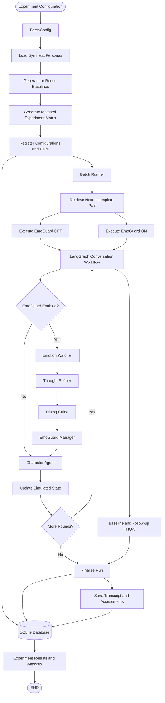
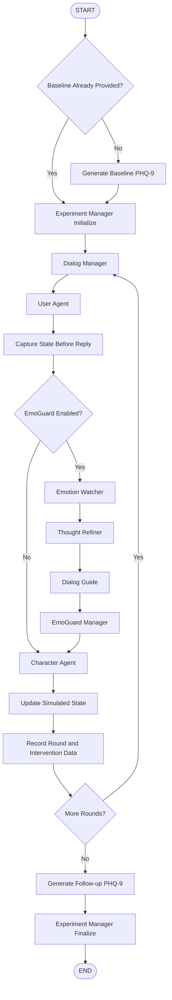
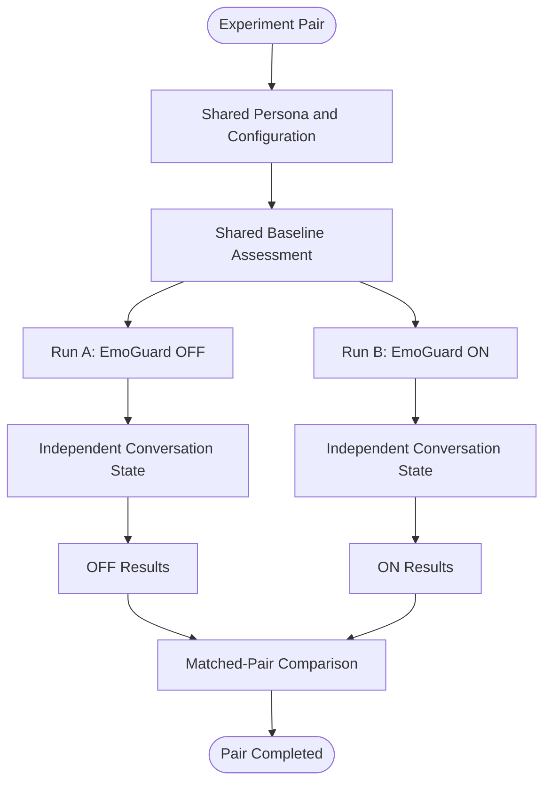

# EmoAgent-Lite 🤖💬

**Authors:** Aryan Pandey, Anshul Kumar, Y Madhu Reddy

### A modular, multi-agent conversational research prototype built with LangGraph, Ollama, and SQLAlchemy

**EmoAgent-Lite** is an independent, lightweight reproduction inspired by the EmoAgent framework for studying safety in mental-health-related human–AI conversations.

The project combines synthetic user personas, character-driven conversational agents, dialogue management, psychological assessment, and an optional safety pipeline called **EmoGuard-Lite**.

Built using LangGraph and locally hosted language models through Ollama, the system supports both interactive conversations and controlled batch experiments. Its experiment infrastructure provides matched ON/OFF comparisons, persistent experiment records, baseline reuse, crash recovery, and structured artifact storage.

> **Current version: V4.3 — Pilot Testing.**  
> The current development focus is evaluating the batch experiment pipeline using synthetic personas, four character profiles, two dialogue styles, and EmoGuard ON/OFF conditions.


---

## Table of Contents

- [Project Overview](#project-overview)
- [Project Roadmap](#project-roadmap)
- [V4 Architecture](#v4-architecture)
- [V4 Modules and Responsibilities](#v4-modules-and-responsibilities)
- [Batch Experiment Design](#batch-experiment-design)
- [Project Structure](#project-structure)
- [Requirements](#requirements)
- [Setup and Installation](#setup-and-installation)
- [Running the Project](#running-the-project)
- [Experiment Configuration](#experiment-configuration)
- [Assessments and Evaluation](#assessments-and-evaluation)
- [EmoGuard ON/OFF Comparison](#emoguard-onoff-comparison)
- [Database and Experiment Artifacts](#database-and-experiment-artifacts)
- [Testing](#testing)
- [Development History](#development-history)
- [Safety, Privacy, and Limitations](#safety-privacy-and-limitations)
- [Future Development](#future-development)
- [License](#license)

---

## Project Overview

EmoAgent-Lite is designed to investigate how conversational safety mechanisms can be implemented in a resource-constrained, locally executable multi-agent system.

The framework separates the following responsibilities:

| Component | Responsibility |
|---|---|
| User Agent | Simulates a fictional persona using a structured psychological profile. |
| Character Agent | Generates character-driven conversational responses. |
| Dialog Manager | Guides topic progression and helps identify repetitive conversations. |
| Experiment Manager | Controls conversation rounds and experiment lifecycle. |
| Assessment Module | Generates baseline and follow-up synthetic PHQ-9 assessments. |
| EmoGuard-Lite | Provides optional emotion, thought-pattern, and dialogue-safety guidance. |
| Batch Experiment Manager | Generates and executes controlled experiment configurations. |
| Storage Layer | Persists personas, configurations, experiment pairs, runs, and artifacts. |

### Main objectives

- Reconstruct the core ideas of the original EmoAgent framework independently.
- Run language models locally without requiring paid LLM APIs.
- Support multiple synthetic personas, character profiles, and dialogue styles.
- Compare conversations with and without EmoGuard-Lite.
- Provide reproducible and persistent batch experiments.
- Evaluate simulated assessment changes and safety-intervention activity.
- Support future scaling to larger synthetic-persona benchmarks.

**Important:** EmoAgent-Lite is a research prototype. It is not a clinical diagnosis, treatment, or mental-health decision-support system.

---

## Project Roadmap

### V1 — Two-Agent Conversation

The initial version introduced a simple two-agent conversational workflow.

- Agent A: optimistic and constructive.
- Agent B: analytical and constructively critical.
- Shared conversation state.
- Alternating agent turns.
- Configurable response limits.
- Local LLM integration through Ollama.
- LangGraph-based execution.

### V2 — Simulated User and Character-Based Interaction

V2 introduced synthetic personas and experiment-level assessments.

- Synthetic User Agent.
- Character Agent with configurable profiles.
- Experiment Manager.
- Simulated-state tracking.
- Baseline and follow-up PHQ-9 assessments.
- Score comparison.

### V3 — Dialogue Management and EmoGuard

V3 expanded the architecture with conversational guidance and optional safety processing.

**V3.1 — Dialogue Styles**

- Introduced Meow and Roar dialogue styles.
- Separated character identity from dialogue-style instructions.
- Loaded style configurations from JSON.

**V3.2 — Dialog Manager**

- Semantic topic guidance.
- Repetitive conversation and loop detection.
- Context-aware dialogue progression.

**V3.3 — Unified Assessments**

- Unified `assessment_records` structure.
- PHQ-9 baseline and follow-up.
- Optional PDI-21 topic prototype.
- Assessment metadata and structured scoring.

**V3.4 — EmoGuard Integration**

Introduced the optional safeguard pipeline:

1. Emotion Watcher.
2. Thought Refiner.
3. Dialog Guide.
4. EmoGuard Manager.

EmoGuard can be enabled or disabled to support controlled comparisons.

### V4 — Persistent Experiments and Batch Evaluation

V4 transforms the interactive prototype into an experiment-oriented research framework.

**V4.1 — Database Layer**

- SQLite database integration.
- SQLAlchemy models.
- Pydantic schemas and validation.
- Repository-based database operations.
- Persistent personas, experiment configurations, pairs, runs, and artifacts.
- Persona profile hashing and validation.

**V4.2.1 — Interactive and Batch Compatibility**

- Updated the interactive implementation to coexist with batch execution.
- Added support for externally provided baseline assessments.
- Added batch-related state and configuration handling.
- Preserved the interactive conversation workflow.

**V4.2.2 — Batch Infrastructure**

Introduced the `batch/` package.

- Experiment configuration.
- Experiment matrix generation.
- Matched-pair generation.
- Baseline management.
- Experiment registration.

**V4.2.3 — Batch Execution and Testing**

- Batch runner.
- Persistent run execution.
- Experiment artifact generation.
- Recovery of incomplete runs.
- Batch validation and automated tests.
- Progress monitoring using `tqdm`.

**V4.3 — Pilot Testing (Current)**

Current development focuses on testing the complete batch pipeline.

- Five synthetic personas for the pilot.
- Four character profiles: Alex, Demon, Joker, and Sukuna.
- Two dialogue styles: Meow and Roar.
- One replicate.
- Six dialogue rounds per session.
- Two conditions: EmoGuard OFF and ON.
- PHQ-9 baseline and follow-up.
- EmoGuard intervention every three rounds.
- Sequential execution to accommodate limited GPU resources.

---

## V4 Architecture

V4 separates experiment registration, batch execution, conversation orchestration, and persistent storage.

### 1. Overall V4 batch architecture



**Note:** The OFF and ON conditions are matched experimental runs, not parallel executions. The current pilot uses sequential execution (`max_concurrent_runs=1`).

### 2. LangGraph conversation workflow

Each batch run uses the same underlying conversational graph as the interactive system, with batch-specific state and assessment handling.



When a batch run provides an existing baseline, the graph reuses that assessment rather than generating another one. Interactive runs can generate their own baseline.

### 3. Matched-pair experiment workflow

Each experimental pair contains two runs with the same persona, character, dialogue style, and replicate.



The two runs use the same experimental configuration and baseline but maintain independent conversation states.

---

## V4 Modules and Responsibilities

| Module | Responsibility |
|---|---|
| `agent/state.py` | Defines graph state, persona data, conversation history, simulated state, assessment records, and EmoGuard fields. |
| `agent/nodes.py` | Implements User Agent, Character Agent, dialogue handling, and simulated-state updates. |
| `agent/graph.py` | Defines the LangGraph workflow and conditional execution paths. |
| `batch/config.py` | Defines batch experiment configuration and validation. |
| `batch/matrix.py` | Generates and validates experiment matrices and matched pairs. |
| `batch/baselines.py` | Creates or reuses baseline assessment records. |
| `batch/registration.py` | Registers experiment configurations, pairs, and individual runs in storage. |
| `batch/runner.py` | Executes batch runs, handles completion and failures, and saves experiment artifacts. |
| `storage/models.py` | Defines SQLAlchemy database models. |
| `storage/schemas.py` | Defines Pydantic schemas and validation rules. |
| `storage/repository.py` | Implements database operations and experiment persistence. |
| `emoguard/` | Contains the optional safeguard pipeline. |
| `manager/` | Controls conversation rounds and experiment lifecycle. |
| `assessment/` | Contains assessment definitions, nodes, and scoring logic. |
| `llm/provider.py` | Configures the local Ollama language model. |
| `tests/` | Contains automated tests for batch execution, validation, persistence, and recovery. |

### EmoGuard components

| Component | Responsibility |
|---|---|
| Emotion Watcher | Identifies possible emotional signals and distress indicators. |
| Thought Refiner | Identifies possible assumptions and thought patterns for exploration. |
| Dialog Guide | Suggests a sensitive and contextually relevant response strategy. |
| EmoGuard Manager | Consolidates analysis into guidance for the Character Agent. |

The modules provide LLM-generated experimental guidance, not validated psychological measurements or diagnoses.

---

## Batch Experiment Design

V4 supports controlled experiments across multiple dimensions.

### Experimental dimensions

| Dimension | Pilot configuration |
|---|---:|
| Synthetic personas | 5 |
| Character profiles | 4 |
| Dialogue styles | 2 |
| Replicates | 1 |
| Conditions | 2 |
| Dialogue rounds per session | 6 |
| EmoGuard interval | Every 3 rounds |
| Assessment | PHQ-9 |
| Execution | Sequential |

### Character profiles

- `alex`
- `demon`
- `joker`
- `sukuna`

### Dialogue styles

- `meow`
- `roar`

### Experimental conditions

- **OFF:** EmoGuard disabled.
- **ON:** EmoGuard enabled.

### Pilot experiment size

The planned pilot configuration produces:

| Quantity | Expected count |
|---|---:|
| Matched pairs | 40 |
| OFF sessions | 40 |
| ON sessions | 40 |
| Total sessions | 80 |
| Dialogue rounds | 480 |
| ON intervention events | 80 |
| Baseline assessments | 5 |

With six rounds and an intervention interval of three, the expected EmoGuard intervention rounds are `[3, 6]` for each ON session.

These are configuration-derived counts, not reported experimental results.

### Planned larger benchmark

A larger benchmark is planned when sufficient computational resources are available.

| Dimension | Planned configuration |
|---|---:|
| Personas | 100 |
| Characters | 4 |
| Dialogue styles | 2 |
| Replicates | 3 |
| Conditions | 2 |
| Rounds per session | 6 |
| Matched pairs | 2,400 |
| Total sessions | 4,800 |
| Total dialogue rounds | 28,800 |
| Expected ON interventions | 4,800 |
| Baseline assessments | 300 |

The larger benchmark is planned future work and should not be interpreted as completed experimentation.

---

## Project Structure

The following structure represents the V4 architecture. Some files may be added or renamed as development continues.

```text
EmoAgent-Lite/
│
├── agent/
│   ├── __init__.py
│   ├── state.py
│   ├── nodes.py
│   └── graph.py
│
├── assessment/
│   ├── __init__.py
│   ├── phq9.py
│   ├── pdi.py
│   └── ...
│
├── batch/
│   ├── __init__.py
│   ├── config.py
│   ├── matrix.py
│   ├── baselines.py
│   ├── registration.py
│   └── runner.py
│
├── data/
│   ├── users.json
│   ├── all_users.json
│   └── characters/
│       ├── alex.json
│       ├── demon.json
│       ├── joker.json
│       └── sukuna.json
│
├── emoguard/
│   ├── __init__.py
│   └── ...
│
├── llm/
│   └── provider.py
│
├── manager/
│   └── node.py
│
├── storage/
│   ├── __init__.py
│   ├── models.py
│   ├── schemas.py
│   └── repository.py
│
├── tests/
│   ├── ...
│   └── run_pilot.py
│
├── results/
│   ├── artifacts/
│   │   └── <config_id>/
│   │       └── <run_id>/
│   │           ├── transcript.json
│   │           ├── assessment.json
│   │           └── emoguard_log.json
│   └── emoagent_v4_pilot.db
│
├── .env
├── .env.example
├── .gitignore
├── requirements.txt
├── run_agents.py
└── README.md
```

**Note:** The tree is representative. The exact contents of `emoguard/`, `assessment/`, and `tests/` should be checked against the current repository before treating this as a complete file inventory.

Generated databases, experiment outputs, and artifacts should be kept separate from source code and excluded from Git where appropriate.

---

## Requirements

- Python 3.11 or a compatible version supported by the dependencies.
- Git.
- Ollama.
- A locally downloaded LLM.
- LangGraph.
- LangChain Ollama integration.
- SQLAlchemy.
- Pydantic.
- SQLite.
- tqdm for batch progress monitoring.
- pytest for automated tests.

### Recommended local model

```bash
ollama pull llama3.1:8b
```

The default experimental model is `llama3.1:8b`, subject to the current configuration.

---

## Setup and Installation

### 1. Clone the repository

```bash
git clone https://github.com/ltd-ARYAN-pvt/EmoAgent-Lite.git
cd EmoAgent-Lite
```

### 2. Create a virtual environment

**Windows PowerShell**

```powershell
python -m venv .venv
.\.venv\Scripts\Activate.ps1
```

**Linux/macOS**

```bash
python3 -m venv .venv
source .venv/bin/activate
```

### 3. Install dependencies

```bash
python -m pip install --upgrade pip
pip install -r requirements.txt
```

For development and testing:

```bash
pip install pytest tqdm
```

### 4. Install Ollama

Install Ollama from:

https://ollama.com/

Download the model:

```bash
ollama pull llama3.1:8b
```

Check installed models:

```bash
ollama list
```

### 5. Configure environment variables

Create a `.env` file in the project root.

```dotenv
OLLAMA_MODEL=llama3.1:8b
OLLAMA_BASE_URL=http://localhost:11434
```

Use the exact environment variable names expected by `llm/provider.py`.

---

## Running the Project

### Interactive mode

Launch the interactive experiment:

```bash
python run_agents.py
```

This mode supports interactive persona-based conversations and the available assessment and EmoGuard configuration options.

### Batch pilot mode

The batch pilot entry point is:

```bash
python tests/run_pilot.py
```

The pilot script configures the selected personas, characters, dialogue styles, replicates, conditions, and execution settings before registering and executing the experiment.

The current pilot configuration uses:

- 5 personas.
- 4 characters.
- 2 dialogue styles.
- 1 replicate.
- 2 conditions.
- 6 rounds per session.
- EmoGuard interval of 3.
- Sequential execution.

### Batch execution workflow

The batch pipeline performs the following operations:

1. Load synthetic persona profiles.
2. Generate or reuse baseline assessments.
3. Generate the experiment matrix.
4. Validate matched-pair configurations.
5. Register the experiment and runs in SQLite.
6. Execute OFF and ON runs.
7. Invoke the LangGraph conversation workflow.
8. Generate follow-up PHQ-9 assessments.
9. Persist transcripts, assessments, and EmoGuard logs.
10. Update experiment and pair completion status.

### Batch progress monitoring

The batch runner uses `tqdm` to display execution progress, including:

- Completed sessions.
- Total sessions.
- Progress percentage.
- Estimated remaining time.
- Current persona.
- Character profile.
- Dialogue style.
- Replicate.
- Experimental condition.

The progress display monitors execution; it does not increase inference speed.

---

## Experiment Configuration

Batch experiments are defined using `BatchConfig`.

An illustrative configuration:

```python
from dataclasses import replace
from batch.config import BatchConfig

config = replace(
    BatchConfig(),
    config_id="emoagent-v4.3-pilot-5p-r1-6rounds",
    experiment_name="EmoAgent-Lite Pilot",
    persona_count=5,
    character_ids=(
        "alex",
        "demon",
        "joker",
        "sukuna",
    ),
    replicates=1,
    dialogue_styles=("meow", "roar"),
    conditions=("off", "on"),
    max_rounds=6,
    assessments=("phq9",),
    emoguard_interval=3,
    max_concurrent_runs=1,
    model_name="llama3.1:8b",
)
```

The configuration is registered and persisted with a unique `config_id`.

**Important:** If an experiment configuration changes, use a new `config_id`. This preserves experiment history and prevents different configurations from being mixed.

### Matched-pair design

Each pair contains:

- The same synthetic persona.
- The same character.
- The same dialogue style.
- The same replicate.
- The same baseline assessment.
- The same initial simulated state.

The OFF and ON runs receive independent conversation states.

The execution order is alternated across pairs to reduce systematic order effects.

### Sequential execution

The pilot initially uses:

```python
max_concurrent_runs=1
```

This avoids running multiple LLM-heavy experiments simultaneously on limited GPU memory.

Concurrency can be reconsidered after measuring memory usage and inference stability.

---

## Assessments and Evaluation

### PHQ-9

The batch experiment uses PHQ-9 as its primary synthetic assessment.

Each of the nine items receives a score from 0 to 3.

$$
S_{\mathrm{PHQ9}} = \sum_{i=1}^{9} r_i
$$

The total score ranges from 0 to 27.

Score change:

$$
\Delta S = S_{\mathrm{final}} - S_{\mathrm{initial}}
$$

- Positive: simulated score increased.
- Negative: simulated score decreased.
- Zero: no change in the total score.

These are simulated assessment responses, not clinical measurements.

### Baseline reuse

Baseline assessments are generated or retrieved before batch execution.

For matched OFF/ON runs, the same baseline assessment is reused. This ensures that the comparison begins from the same assessment record.

The pilot with five personas and one replicate requires five baseline assessments.

### PDI-21

An optional PDI-21 topic prototype exists in the interactive implementation.

The current batch experiment uses PHQ-9 only.

The PDI prototype is not an official standardized administration and should not be interpreted using clinical norms.

### Additional evaluation metrics

The framework can support further analysis of:

- Mean baseline and follow-up PHQ-9 scores.
- Mean score change.
- Standard deviation of score changes.
- Matched-pair differences.
- EmoGuard intervention counts.
- Intervention rounds.
- Character-dependent score changes.
- Dialogue-style-dependent variations.

---

## EmoGuard ON/OFF Comparison

### OFF condition

- EmoGuard is disabled.
- The User Agent generates the synthetic persona's response.
- The Dialog Manager provides conversation guidance.
- The Character Agent generates a reply.
- The simulated state is updated.
- No EmoGuard intervention is recorded.

### ON condition

- EmoGuard is enabled.
- The User Agent generates the synthetic persona's response.
- The Dialog Manager provides conversation guidance.
- EmoGuard runs at the configured interval.
- Its four components generate and consolidate safety guidance.
- The Character Agent uses the guidance when generating its reply.
- The simulated state and intervention information are recorded.

### Intervention scheduling

With six rounds and an interval of three:

```text
Round 1: No intervention
Round 2: No intervention
Round 3: EmoGuard intervention
Round 4: No intervention
Round 5: No intervention
Round 6: EmoGuard intervention
```

Expected intervention rounds:

```python
[3, 6]
```

The OFF condition should have no intervention rounds.

The batch result validator checks the expected intervention schedule for completed runs.

---

## Database and Experiment Artifacts

V4 uses SQLite and SQLAlchemy for persistent experiment management.

### Database models

The storage layer includes:

| Model | Purpose |
|---|---|
| `Persona` | Stores synthetic persona information and profile hashes. |
| `ExperimentConfig` | Stores experiment configuration and configuration hashes. |
| `BaselineAssessment` | Stores reusable baseline assessment records. |
| `ExperimentPair` | Stores matched OFF/ON experiment pairs. |
| `ExperimentRun` | Stores individual experiment execution records. |
| `ExperimentArtifact` | Stores references and data for generated experiment artifacts. |

### Artifact structure

Each run produces structured artifacts under:

```text
results/artifacts/
└── <config_id>/
    └── <run_id>/
        ├── transcript.json
        ├── assessment.json
        └── emoguard_log.json
```

**transcript.json**

Contains the conversation history and relevant execution information.

**assessment.json**

Contains baseline and follow-up assessment information.

**emoguard_log.json**

Contains EmoGuard intervention information, including scheduled rounds and module outputs where applicable.

### Crash recovery

The batch system supports recovery of incomplete experiments.

- Completed runs are not unnecessarily re-executed.
- Failed runs are recorded.
- Stale or incomplete runs can be identified.
- Existing experiment pairs can be resumed.
- Previously saved artifacts remain available.

### Persona integrity

Persona records use profile hashing to detect changes.

If a persona profile differs from the previously stored version, the storage layer rejects the mismatch rather than silently overwriting the existing record.

Use a separate database for a new experimental dataset or configuration when appropriate. Do not delete existing experiment databases merely to resolve a persona mismatch.

---

## Testing

V4 includes automated tests for the experiment and persistence infrastructure.

Run the test suite:

```bash
pytest -v
```

Tests cover areas such as:

- Experiment matrix generation.
- Matched-pair validation.
- Configuration validation.
- Baseline generation and reuse.
- Database registration.
- Experiment-run validation.
- Artifact persistence.
- Intervention-round validation.
- Run completion and failure handling.
- Crash recovery.

For a focused test:

```bash
pytest tests/test_batch_results.py -v
```

Use the actual test filenames present in the repository.

---

## Development History

The following milestones are reflected in the recent Git history.

| Version / milestone | Date | Development |
|---|---|---|
| V4.1 | Oct 31, 2026 | Added database layer. |
| V4.2.1 | Nov 1, 2026 | Interactive workflow updated for batch compatibility. |
| V4.2.2 | Nov 1, 2026 | Added batch package. |
| V4.2.3 | Nov 1, 2026 | Added batch execution files and tested them. |
| V4.3 | Nov 2, 2026 | Pilot testing. |

### Recent Git commits

```text
V4.3 Pilot Testing

V4.2.3 added batch files and test it
V4.2.2 added batch folder
V4.2.1 Interactive with batch updation
Added tests dir
V4.1 Added database layer
```

---

## Safety, Privacy, and Limitations

EmoAgent-Lite is a research prototype, not a clinical diagnosis, treatment, or mental-health intervention system.

- Experiments use synthetic personas rather than real patients.
- Simulated PHQ-9 responses are not clinical measurements.
- Score changes do not establish therapeutic effectiveness.
- The current batch implementation uses PHQ-9 only.
- The system uses Llama 3.1 8B instead of the original framework's proprietary models.
- The implementation is an independent reproduction, not an exact replication.
- EmoGuard outputs are experimental LLM-generated suggestions, not validated safety assessments.
- The current ablation compares the complete EmoGuard pipeline ON versus OFF; it does not isolate individual module contributions.
- Experiments are initially sequential due to limited computational resources.
- The larger 100-persona benchmark remains planned work.

---

## Future Development

Potential directions include:

- Completing and analysing the V4.3 pilot.
- Extending the experiment to 100 synthetic personas and three replicates.
- Module-wise EmoGuard ablation.
- Character-dependent risk analysis.
- Dialogue-style-dependent comparisons.
- Improved experiment visualization and reporting.
- Parallel execution and inference optimization.
- Additional assessment prototypes.
- More systematic response-level safety evaluation.
- Improved structured-output validation and error recovery.
- Optional integration with experiment-tracing and observability tools.

---

## License

No license yet