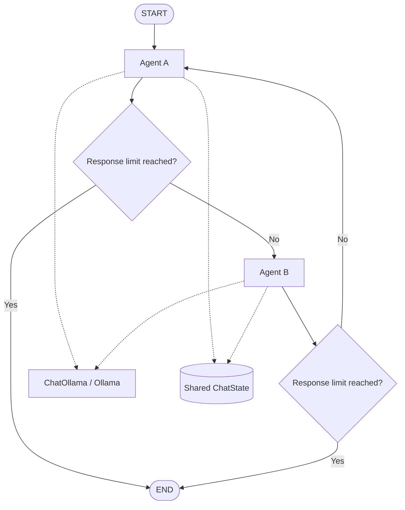
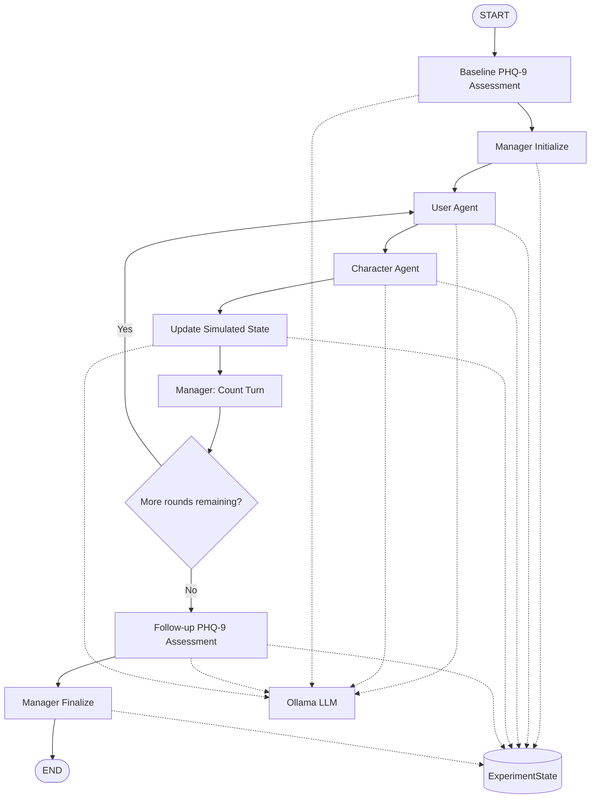

# EmoAgent Lite 🤖💬

**Authors:** Aryan Pandey, Anshul Kumar, Madhu Sudhana Reddy

### A modular, multi-agent conversational system built with LangGraph and Ollama

> **EmoAgent Lite** is an evolving multi-agent research prototype for experimenting with agent conversations, character-driven interactions, simulated personas, structured assessments, and evaluation. V1 implements a two-agent conversation. V2 extends the system with a simulated User Agent, a Character Agent, a Manager Agent, and synthetic PHQ-9 baseline and follow-up assessments.


---

## Project roadmap

### V1 — Two-Agent Conversation

- **Agent A:** optimistic and constructive.
- **Agent B:** analytical and constructively critical.
- Shared conversation state and alternating turns.
- Configurable response limit and response validation.
- Local LLM integration through Ollama.
- LangGraph-based orchestration.

### V2 — Simulated User, Character, and Manager

- **User Agent:** simulates a persona loaded from `data/users.json`.
- **Character Agent:** roleplays a configurable character loaded from `data/character/`, with Sukuna as an example.
- **Manager Agent:** initializes the experiment, tracks completed conversation rounds, and coordinates the workflow.
- **Baseline assessment:** generates synthetic PHQ-9 responses before the conversation.
- **Follow-up assessment:** generates another set of synthetic PHQ-9 responses after the conversation.
- **Scoring:** validates the nine responses, calculates totals, and compares baseline and follow-up scores.
- **Simulated state:** tracks features such as mood, distress level, perceived stress, recent experiences, and current interpretation.
- **Experiment output:** displays assessment results and conversation activity in the terminal.

The assessments are generated by the configured LLM based on the simulated persona and state. They are experimental synthetic data, not actual participant responses or clinical measurements.

### V3 — EmoGuard and EmoEval

- **EmoGuard:** checks model outputs against defined safety and privacy rules.
- **EmoEval:** evaluates relevance, empathy, consistency, and instruction following.
- Structured test cases, evaluation criteria, and experiment reports.
- Explicit handling of configured safety-review flags.

### V4 — Backend and Frontend

- Expose the workflow through a FastAPI backend.
- Add a chat frontend, request/response schemas, and error handling.
- Add automated tests and configurable experiment settings.
- Keep sensitive data and secrets out of frontend code and logs.

### V5 — Results Showcase

- Present example conversations, architecture diagrams, screenshots, and demo material.
- Report test results, latency, resource usage, and evaluation methodology.
- Document limitations and distinguish technical performance from clinical validation.

---

## Architecture

### V1 — Two-agent conversation graph

V1 alternates between Agent A and Agent B until the configured response limit is reached.



**Key idea:** LangGraph controls execution order and state transitions, while the LLM generates each agent's response. Both agents can use the same underlying model with different prompts.

### V2 — Simulated interaction and assessment graph

V2 adds a manager-controlled experiment around a simulated user and a configurable character.



**V2 workflow:**

1. The Baseline Assessment generates nine synthetic PHQ-9 responses.
2. The Manager validates the baseline score and initializes the round counter.
3. The User Agent produces the simulated persona's opening message.
4. The Character Agent responds according to the selected character profile.
5. The simulated state is updated after each exchange, and the Manager increments the completed-round count.
6. The graph repeats the interaction until the configured number of rounds is reached.
7. The Follow-up Assessment generates nine new synthetic responses.
8. The Manager calculates the follow-up score, compares it with baseline, and returns the experiment result.

The assessment nodes return structured response data to the graph state rather than adding questionnaire answers to the conversation transcript.

---

## Project structure

The structure below shows the main modules used by the V1 and V2 workflows. Some supporting files may vary as the project evolves.

```text
EmoAgent-Lite/
├── agent/
│   ├── __init__.py
│   ├── state.py               # ChatState and ExperimentState
│   ├── prompts.py              # Agent prompts
│   ├── nodes.py                # Agent nodes and simulated-state updates
│   └── graph.py                # V1 and V2 graph definitions
├── assessment/
│   ├── phq9.py                 # PHQ-9 questions and validation
│   ├── nodes.py                # Baseline and follow-up assessments
│   └── scoring.py              # Score calculation and comparison
├── data/
│   ├── users.json              # Simulated persona profiles
│   ├── persona_loader.py       # Persona loading and lookup
│   └── character/
│       └── sukuna.json         # Example character profile
├── llm/
│   └── provider.py             # Ollama client configuration
├── manager/
│   └── node.py                 # Experiment coordination and finalization
├── schemas/
│   └── simulated_state.py      # Simulated-state schema
├── tests/                      # Automated tests
├── run_agents.py               # V2 experiment runner
├── run_agent.py                # V1 runner, if retained separately
├── .env.example                # Example environment configuration
├── .gitignore
└── README.md
```

> **Note:** The tree is a documentation example. Keep only filenames that actually exist in your repository, and update the entry-point names if your current implementation uses different ones.

---

## Requirements

- Python 3.11 or a compatible version supported by your dependencies.
- [Git](https://git-scm.com/)
- [Ollama](https://ollama.com/)
- A model downloaded into Ollama, such as `qwen3:4b`.
- Python packages: `langgraph`, `langchain-ollama`, and `python-dotenv`.

---

## Setup and installation

### 1. Clone the repository

```bash
git clone https://github.com/ltd-ARYAN-pvt/EmoAgent-Lite.git
cd EmoAgent-Lite
```

Replace `<YOUR_REPOSITORY_URL>` with your repository's Git URL.

### 2. Create a virtual environment

**Windows — PowerShell**

```powershell
python -m venv .venv
.\.venv\Scripts\Activate.ps1
```

**Windows — Command Prompt**

```bat
python -m venv .venv
.venv\Scripts\activate.bat
```

**Linux / macOS**

```bash
python3 -m venv .venv
source .venv/bin/activate
```

If PowerShell blocks activation, you can use Command Prompt or configure the appropriate execution policy for your environment.

### 3. Install dependencies

If the project has a `requirements.txt` file:

```bash
python -m pip install --upgrade pip
pip install -r requirements.txt
```

Otherwise, install the core packages:

```bash
python -m pip install --upgrade pip
pip install langgraph langchain-ollama python-dotenv
```

For development and testing:

```bash
pip install pytest ruff
```

If you add packages during development, update `requirements.txt` so other contributors can reproduce the environment:

```bash
pip freeze > requirements.txt
```

### 4. Install and start Ollama

Install Ollama from [ollama.com](https://ollama.com/), then download the model you intend to use.

For example:

```bash
ollama pull llama3.1:8b
```

Check that the model is available:

```bash
ollama list
```

Ensure the Ollama service is running before launching an experiment. The default local endpoint is `http://localhost:11434`.

### 5. Configure environment variables

Create a `.env` file in the project root:

```dotenv
OLLAMA_MODEL=llama3.1:8b
OLLAMA_BASE_URL=http://localhost:11434
```

Use a model name that matches one returned by `ollama list` and is compatible with your prompts and hardware.

Never commit `.env`, credentials, or real user questionnaire data.

---

## Running the project

### Run V1 — Two-agent conversation

If your V1 runner is retained as `run_agent.py`:

```bash
python run_agent.py
```

This launches the original two-agent conversation workflow.

### Run V2 — Simulated-user experiment

Activate the virtual environment, then run:

```bash
python run_agents.py
```

The V2 runner asks for a persona ID, character ID, and conversation-round limit. For example, it may use persona `1-1`, character `sukuna`, and three rounds, depending on the profiles present in your repository.

The experiment runs through these stages:

- Baseline assessment
- Manager initialization
- Alternating User Agent and Character Agent turns
- Simulated-state updates
- Follow-up assessment
- Manager finalization

The terminal can display individual assessment responses, intermediate scores, conversation messages, and the final score comparison, depending on the output code enabled in your runner.

### Run tests

```bash
python -m pytest
```

If you have not added tests yet, create them under `tests/` for scoring validation, persona loading, graph routing, and experiment-result handling.

---

## Main modules

| Module | Responsibility |
|---|---|
| `llm/provider.py` | Configures the local Ollama chat model. |
| `agent/state.py` | Defines shared conversation and experiment state. |
| `agent/prompts.py` | Stores instructions for agent roles. |
| `agent/nodes.py` | Implements agent behavior and simulated-state updates. |
| `agent/graph.py` | Defines the V1 and V2 LangGraph workflows. |
| `assessment/phq9.py` | Defines questionnaire items and valid response values. |
| `assessment/nodes.py` | Generates baseline and follow-up assessment responses. |
| `assessment/scoring.py` | Validates responses, calculates totals, and compares scores. |
| `manager/node.py` | Initializes experiments, counts rounds, and builds final results. |
| `data/persona_loader.py` | Loads persona profiles and looks up persona IDs. |
| `run_agent.py` | Runs V1, if retained in the current repository. |
| `run_agents.py` | Runs the V2 experiment. |

---

## Understanding the synthetic PHQ-9 results

Each assessment consists of nine responses, with each item scored from 0 to 3. The total ranges from 0 to 27.

The experiment compares the baseline and follow-up totals:

**Score change = Follow-up score − Baseline score**

- A positive change means the synthetic score increased.
- A negative change means the synthetic score decreased.
- Zero means the two synthetic totals are unchanged.

These results are generated by an LLM to support software experimentation. They are **not clinical assessments, diagnoses, or evidence that the conversation caused a change in mental health**. LLM-generated responses can be inconsistent across runs.

The ninth PHQ-9 item concerns thoughts of death or self-harm. A nonzero response should be recorded as a review flag in the experiment, even when the data is synthetic. Such a flag is not itself a clinical determination.

---

## Troubleshooting

**Ollama connection error**

- Verify that Ollama is installed and running.
- Check `OLLAMA_BASE_URL` in `.env`.
- Run `ollama list` and verify that `OLLAMA_MODEL` matches an installed model.

**Python cannot find a package**

- Activate `.venv`.
- Install the missing package inside the active environment.
- Check the selected interpreter in your IDE.

**Persona or character file not found**

- Confirm that the persona ID exists in `data/users.json`.
- Confirm that the character profile exists under `data/character/`.
- Check that the runner builds paths relative to the project root.

**Invalid assessment response**

- Ensure the assessment parser accepts only the values `0`, `1`, `2`, and `3`.
- Check the model response and retry or fail clearly if the output is invalid.

**V2 score does not appear in the terminal**

- Confirm that `run_agents.py` prints assessment fields returned by graph updates.
- Check that `manager_finalize()` returns the final score comparison.
- Print the final result after the graph finishes if you want a compact experiment summary.

**Agents speak about each other in third person**

- Instruct each agent to speak directly to the other participant.
- Review the character profile and prompt.
- Inspect the transcript passed into each LLM call.

---

## Safety, privacy, and scope

EmoAgent Lite is a software research prototype, not a mental-health treatment or clinical decision-support system.

- Use fictional or appropriately consented data.
- Do not place identifiable or sensitive participant data in public repositories.
- Define data retention, access, and deletion policies before storing sensitive information.
- Keep assessment records separate from conversational messages when appropriate.
- Avoid prompts that deliberately manipulate questionnaire scores.
- Do not design character behavior to encourage self-harm or deliberately exploit a simulated persona's vulnerabilities.
- Treat safety-review flags as signals for review, not as diagnoses.
- Evaluate software behavior separately from any claims about clinical effectiveness.

## License

No license yet.