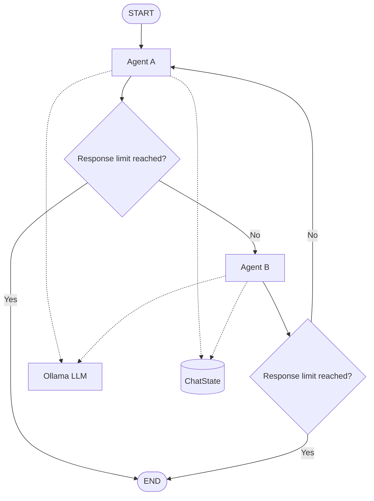
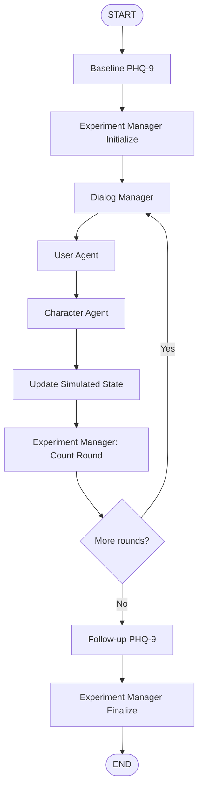
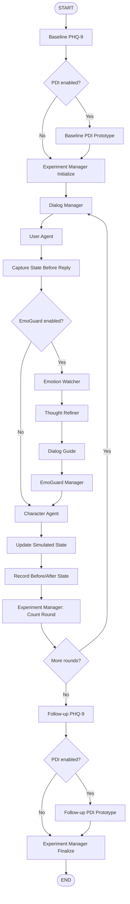

# EmoAgent Lite 🤖💬

**Authors:** Aryan Pandey, Anshul Kumar, Madhu Sudhana Reddy

### A modular, multi-agent conversational research prototype built with LangGraph and Ollama

**EmoAgent Lite** is an evolving multi-agent system for experimenting with character-driven conversations, synthetic personas, dialogue management, structured assessments, simulated-state tracking, and optional conversational safeguards.

The project uses LangGraph to orchestrate agent workflows and Ollama to run local language models. Its architecture separates conversation generation, experiment management, assessment logic, and safeguard processing into modular components.

> **Current development focus: V3.4 — EmoGuard integration.** EmoGuard can be enabled or disabled to compare simulated state changes and conversational outputs with and without safeguard guidance.


---

## Table of contents

- [Project roadmap](#project-roadmap)
- [Architecture](#architecture)
- [V3 modules and responsibilities](#v3-modules-and-responsibilities)
- [Project structure](#project-structure)
- [Requirements](#requirements)
- [Setup and installation](#setup-and-installation)
- [Running the project](#running-the-project)
- [Assessments and scoring](#assessments-and-scoring)
- [EmoGuard ON/OFF comparison](#emoguard-onoff-comparison)
- [Troubleshooting](#troubleshooting)
- [Safety, privacy, and limitations](#safety-privacy-and-limitations)
- [Future development](#future-development)
- [License](#license)

---

## Project roadmap

### V1 — Two-Agent Conversation

The initial version implements a simple two-agent conversational workflow.

- **Agent A:** optimistic and constructive.
- **Agent B:** analytical and constructively critical.
- Shared conversation state and alternating turns.
- Configurable response limits.
- Local language-model integration through Ollama.
- LangGraph-based execution and state transitions.

### V2 — Simulated User, Character, and Experiment Manager

V2 introduces persona-based conversations and experiment-level assessment.

- **User Agent:** simulates a fictional persona loaded from the project's persona data.
- **Character Agent:** roleplays a configurable character, such as Sukuna.
- **Experiment Manager:** initializes experiments, controls conversation rounds, and coordinates finalization.
- **Simulated-state tracking:** maintains mood, distress level, perceived stress, recent experiences, and current interpretation.
- **Baseline and follow-up PHQ-9:** generates synthetic assessment responses before and after the conversation.
- **Score comparison:** calculates baseline and follow-up totals and reports the difference.

### V3 — Dialogue Management, Assessments, and EmoGuard

V3 develops the prototype into a configurable multi-agent experiment with guided conversations, multiple assessment types, and optional safeguard processing.

#### V3.1 — Dialogue Styles

- Introduces selectable dialogue styles: **Meow** and **Roar**.
- Loads style instructions from JSON profiles.
- Keeps dialogue-style instructions separate from the character's identity and personality.
- Allows the same character to respond using different conversational styles.

#### V3.2 — Dialog Manager

- Adds a Dialog Manager before each simulated conversation exchange.
- Provides semantic topic guidance to encourage relevant dialogue progression.
- Helps identify repetitive discussion and potential conversational loops.
- Guides the Character Agent toward natural continuation, clarification, or topic shifts.

#### V3.3 — Unified Assessments

- Organizes assessment results into a unified `assessment_records` structure.
- Supports synthetic PHQ-9 baseline and follow-up assessments.
- Adds an optional **PDI-21 topic prototype** alongside PHQ-9.
- Stores responses, scoring summaries, assessment phase, and instrument metadata.
- Keeps assessment responses separate from the conversational transcript.
- Supports configurable assessment selection through `enabled_assessments`.

The PDI component uses topic-based paraphrases rather than the official standardized questionnaire items. It is a non-standardized prototype and must not be interpreted as a validated PDI administration or diagnostic result.

#### V3.4 — EmoGuard Safeguard Layer

EmoGuard is an optional safeguard pipeline that analyzes the latest simulated-person turn and provides guidance to the Character Agent.

Its four components are:

1. **Emotion Watcher:** identifies possible emotional signals, distress indicators, and potential support needs from the conversation.
2. **Thought Refiner:** identifies possible assumptions, interpretations, contradictions, or thinking patterns that could be explored collaboratively.
3. **Dialog Guide:** converts the analyses into practical suggestions for a sensitive, relevant response.
4. **EmoGuard Manager:** consolidates module outputs into concise guidance for the Character Agent.

Additional capabilities:

- Switch EmoGuard ON or OFF for an experiment.
- Preserve the existing Dialog Manager and Experiment Manager.
- Capture simulated state before and after each character response.
- Record module outputs and consolidated character guidance when EmoGuard is enabled.
- Compare the two configurations using the same logging structure.

EmoGuard outputs are generated by an LLM. They are experimental suggestions, not validated emotion measurements, psychological diagnoses, or proof of improved outcomes.

#### Planned evaluation component — EmoEval

EmoEval is a proposed evaluation layer for measuring characteristics such as relevance, empathy, consistency, and instruction following. Automated evaluation criteria, benchmark datasets, and reporting should be considered planned until implemented and tested in the repository.

### V4 — Persistence, Evaluation, and Scale

Planned improvements include:

- Persistent experiment records and reproducible run configurations.
- Automated benchmark experiments across larger sets of synthetic personas.
- Structured logs, error tracking, and experiment tracing.
- Model comparisons and performance measurements.
- More robust JSON handling, retries, and failure recovery.
- Optional API integration and a frontend interface.

### V5 — Results Showcase

- Architecture diagrams and example conversations.
- Comparative EmoGuard ON/OFF results.
- Benchmark tables and experiment reports.
- Latency, resource-usage, and reliability measurements.
- Clear documentation of limitations and evaluation methodology.

---

## Architecture

### V1 — Two-agent conversation graph

V1 alternates between Agent A and Agent B until the response limit is reached.



### V2 — Simulated interaction and assessment graph

V2 wraps the conversation in an experiment workflow.



When PDI is enabled, the baseline PDI assessment runs after baseline PHQ-9 and before experiment initialization. The follow-up PDI assessment runs after follow-up PHQ-9 and before finalization.

### V3.4 — Conversation graph with optional EmoGuard



**Important design distinction:** the Dialog Manager guides conversation direction; EmoGuard provides optional safeguard guidance; and the Experiment Manager controls the experiment lifecycle. These are separate responsibilities.

---

## V3 modules and responsibilities

The table below summarizes the major modules and the roles they play in the V3 workflow.

| Module | Responsibility |
|---|---|
| `agent/state.py` | Defines `ChatState` and `ExperimentState`, including conversation messages, persona information, simulated state, assessment records, dialogue guidance, and EmoGuard data. |
| `agent/nodes.py` | Implements the User Agent, Character Agent, dialogue-style loading, transcript formatting, and simulated-state updates. |
| `agent/graph.py` | Defines the LangGraph workflow, connects assessment and conversation nodes, and routes execution through the optional EmoGuard branch. |
| `dialog_manager.py` or the corresponding Dialog Manager package | Analyzes dialogue context, guides topic progression, and helps manage repetitive or looping conversation. |
| `emoguard/nodes.py` | Implements state snapshots, the Emotion Watcher, Thought Refiner, Dialog Guide, EmoGuard Manager, and per-round logging. |
| `manager/node.py` | Initializes experiments, counts completed rounds, determines when to continue or finish, and builds final experiment results. |
| `assessment/phq9.py` | Defines PHQ-9 assessment data and response validation, according to the current implementation. |
| `assessment/pdi.py` | Defines the PDI-21 topic prototype, its metadata, response validation, and scoring logic. |
| `assessment/pdi_nodes.py` or the corresponding assessment node module | Generates synthetic PDI prototype responses and integrates them into assessment records. |
| `assessment/` | Organizes baseline and follow-up assessment nodes, response processing, and scoring. Exact filenames depend on the current repository layout. |
| `data/users.json` | Stores or references synthetic persona profiles, according to the current data format. |
| `data/character/` | Contains character profiles used by the Character Agent. |
| `data/dialogue_styles/` | Contains JSON configuration files for Meow and Roar dialogue styles. |
| `llm/provider.py` | Configures and provides the local Ollama language model used by the agents. |
| `run_agents.py` | Collects experiment configuration, invokes or streams the graph, and displays conversation and experiment results. |
| `tests/` | Contains automated tests for graph routing, assessments, validation, and experiment behavior, where implemented. |

> File locations can change during development. Update this table if modules are moved, renamed, or split into separate files.

### EmoGuard module responsibilities

| Module | Responsibility |
|---|---|
| **Emotion Watcher** | Identifies possible emotional signals, distress, frustration, uncertainty, and support needs using conversational evidence. |
| **Thought Refiner** | Surfaces possible assumptions, interpretations, contradictions, or thought patterns for gentle exploration without diagnosing the simulated person. |
| **Dialog Guide** | Suggests an appropriate response strategy, possible questions, acknowledgments, and pitfalls to avoid. |
| **EmoGuard Manager** | Consolidates module outputs into concise guidance that respects the character profile and selected dialogue style. |
| **State Snapshot and Logger** | Records the simulated state before and after a response, the module outputs, the character's reply, and whether EmoGuard was enabled. |
| **Character Agent** | Generates the actual character response, using EmoGuard guidance when available while preserving the selected personality and style. |
| **Experiment Manager** | Controls experiment rounds and assessment transitions independently of the EmoGuard Manager. |

---

## Project structure

The following is an illustrative structure based on the current architecture. Keep filenames consistent with the files actually present in your repository.

```text
EmoAgent-Lite/
├── agent/
│   ├── __init__.py
│   ├── state.py
│   ├── nodes.py
│   └── graph.py
├── assessment/
│   ├── __init__.py
│   ├── phq9.py
│   ├── pdi.py
│   ├── pdi_nodes.py
│   └── ...
├── data/
│   ├── users.json
│   ├── character/
│   │   └── sukuna.json
│   └── dialogue_styles/
│       ├── meow.json
│       └── roar.json
├── dialog_manager.py
├── emoguard/
│   ├── __init__.py
│   └── nodes.py
├── llm/
│   └── provider.py
├── manager/
│   └── node.py
├── tests/
├── run_agents.py
├── requirements.txt
├── .env.example
├── .gitignore
└── README.md
```

---

## Requirements

- Python version supported by the project's dependencies.
- Git.
- [Ollama](https://ollama.com/).
- A compatible model downloaded into Ollama.
- Python packages including LangGraph and the appropriate LangChain Ollama integration.

For reproducibility, use a tested Python environment and maintain a `requirements.txt` file.

---

## Setup and installation

### 1. Clone the repository

```bash
git clone https://github.com/ltd-ARYAN-pvt/EmoAgent-Lite.git
cd EmoAgent-Lite
```

### 2. Create a virtual environment

**Windows — PowerShell**

```powershell
python -m venv .venv
.\.venv\Scripts\Activate.ps1
```

**Windows — Command Prompt**

```bat
python -m venv .venv
.\.venv\Scripts\activate.bat
```

**Linux / macOS**

```bash
python3 -m venv .venv
source .venv/bin/activate
```

### 3. Install dependencies

If `requirements.txt` exists:

```bash
python -m pip install --upgrade pip
pip install -r requirements.txt
```

Otherwise, install the packages needed by your current implementation:

```bash
python -m pip install --upgrade pip
pip install langgraph langchain-ollama python-dotenv
```

For development and testing:

```bash
pip install pytest ruff
```

Update `requirements.txt` when dependencies change.

### 4. Install and configure Ollama

Install Ollama from [ollama.com](https://ollama.com/), then download a compatible model.

For example:

```bash
ollama pull llama3.1:8b
```

Check the available models:

```bash
ollama list
```

Make sure the Ollama service is running before launching the experiment.

### 5. Configure environment variables

Create a `.env` file in the project root:

```dotenv
OLLAMA_MODEL=llama3.1:8b
OLLAMA_BASE_URL=http://localhost:11434
```

Use the model name supported by your installation and by the model configuration in `llm/provider.py`.

Do not commit `.env` files, credentials, or sensitive participant data.

---

## Running the project

### Run V1 — Two-agent conversation

If the original V1 runner is still present:

```bash
python run_agent.py
```

### Run V3 — Simulated-person experiment

Run the current experiment entry point:

```bash
python run_agents.py
```

Follow the prompts provided by the runner to select the persona, character, dialogue style, conversation-round limit, assessment configuration, and EmoGuard setting where available.

The workflow can include:

1. Baseline PHQ-9 assessment.
2. Optional baseline PDI topic-prototype assessment.
3. Experiment initialization.
4. Dialog Manager guidance.
5. User Agent turn.
6. Optional EmoGuard analysis and guidance.
7. Character Agent response.
8. Simulated-state update and per-round logging.
9. Experiment round control.
10. Follow-up PHQ-9 assessment.
11. Optional follow-up PDI topic-prototype assessment.
12. Final assessment comparison.

The precise CLI options depend on the current implementation of `run_agents.py`.

---

## Assessments and scoring

### PHQ-9

The prototype generates nine synthetic responses, with each item scored from 0 to 3. The total ranges from 0 to 27.

**Score change = Follow-up score − Baseline score**

- A positive change means the synthetic score increased.
- A negative change means the synthetic score decreased.
- Zero means the synthetic totals are unchanged.

The score difference describes the output of the simulation only. It does not establish that a conversation caused a mental-health improvement or deterioration.

### PDI-21 topic prototype

The optional PDI component uses 21 topic-based prompts inspired by the domains of the Peters Delusions Inventory. It is a prototype, not an official standardized questionnaire administration.

The current record structure includes:

- Instrument and version metadata.
- Assessment phase and data type.
- Whether administration is standardized.
- Individual synthetic responses.
- Endorsement, distress, preoccupation, and conviction values.
- Aggregate prototype scores.

These prototype scores must not be compared with validated clinical norms or treated as diagnostic findings.

### Unified assessment records

Assessment outputs are organized by phase and instrument in `assessment_records`, allowing baseline and follow-up data to be retrieved consistently.

Example structure:

```python
{
    "baseline": {
        "phq9": {
            "instrument": "PHQ-9",
            "phase": "baseline",
            "data_type": "synthetic",
            "responses": [],
            "scores": {"total": 0}
        },
        "pdi": {
            "instrument": "PDI-21-topic-prototype",
            "phase": "baseline",
            "data_type": "synthetic",
            "standardized_administration": False,
            "responses": [],
            "scores": {}
        }
    },
    "followup": {}
}
```

The example illustrates the organization, not a real assessment result. Actual fields and values are determined by the assessment implementation.

---

## EmoGuard ON/OFF comparison

EmoGuard can be enabled or disabled to compare the conversation workflow with and without its guidance.

### EmoGuard OFF

- The User Agent generates the simulated person's turn.
- The pre-response state is captured.
- The Character Agent responds using the character profile, dialogue style, and Dialog Manager guidance.
- The simulated state is updated.
- The logger records the before/after state and the configuration.

### EmoGuard ON

- The User Agent generates the simulated person's turn.
- The pre-response state is captured.
- The Emotion Watcher analyzes possible emotional signals.
- The Thought Refiner identifies possible assumptions or interpretations to explore.
- The Dialog Guide suggests a supportive response strategy.
- The EmoGuard Manager consolidates the suggestions.
- The Character Agent responds using the consolidated guidance.
- The simulated state is updated and logged.

### Example log fields

Each completed round can record:

| Field | Description |
|---|---|
| `round` | Conversation-round identifier. |
| `emoguard_enabled` | Whether EmoGuard was enabled. |
| `user_turn` | The simulated person's latest message. |
| `character_reply` | The character's response. |
| `state_before` | Simulated state captured before the character responds. |
| `state_after` | Simulated state generated after the exchange. |
| `module_outputs` | Emotion Watcher, Thought Refiner, and Dialog Guide outputs when enabled. |
| `character_guidance` | Consolidated EmoGuard Manager recommendations when enabled. |

This structure supports later analysis of simulated-state changes, response differences, and module behavior.

For fairer comparisons, keep the model, persona, character, dialogue style, and other experiment settings fixed. Repeat runs where practical because language-model outputs may vary between runs.

---

## Troubleshooting

### Ollama connection error

- Verify that Ollama is installed and running.
- Check `OLLAMA_BASE_URL` in `.env`.
- Run `ollama list` and confirm the selected model is installed.

### Python cannot find a package

- Activate the project's virtual environment.
- Install the missing package in that environment.
- Confirm the Python interpreter selected by your IDE.

### Persona or character profile not found

- Confirm that the persona exists in the configured persona data.
- Check the character profile directory and filename.
- Verify that file paths are resolved relative to the project directory.

### Invalid JSON from the LLM

Language models may return explanatory text, Markdown fences, or malformed JSON when a node expects structured output.

- Instruct the model to return only the required JSON structure.
- Use structured-output support when compatible with the model and integration.
- Validate parsed results before adding them to graph state.
- Use bounded retries and clear error messages where appropriate.
- Log malformed outputs carefully, without exposing sensitive information.

### EmoGuard does not run

- Confirm that EmoGuard is enabled in the experiment configuration.
- Check that `emoguard/nodes.py` exists and imports successfully.
- Confirm that the conditional edge routes to `emotion_watcher` when enabled.
- Verify that the pipeline connects to `character_agent` and then to the normal state-update path.

### PDI results are missing

- Confirm that `"pdi"` is included in `enabled_assessments`.
- Check the baseline and follow-up PDI routing functions.
- Verify that the PDI assessment nodes merge their results into `assessment_records`.
- Confirm that the finalization code preserves the assessment records.

### Final scores are missing

- Check the return value from `manager_finalize()`.
- Confirm that the runner extracts the final graph state or streamed updates correctly.
- Verify that the output code reads the current `experiment_result` and assessment-record structure.

---

## Safety, privacy, and limitations

EmoAgent Lite is a software research prototype, not a mental-health treatment, diagnostic system, or validated clinical decision-support tool.

- Use fictional or appropriately consented data.
- Avoid committing identifiable or sensitive participant information.
- Define data-retention, access, and deletion policies before storing sensitive information.
- Keep assessment records separate from conversational messages where appropriate.
- Treat simulated distress, mood, and stress values as model-generated state features, not validated psychometric measures.
- Treat EmoGuard outputs as advisory hypotheses, not established facts about a person's emotional or cognitive state.
- Do not assume a belief is pathological based on cultural, religious, or personal differences alone.
- Avoid designing character behavior to manipulate vulnerabilities or encourage self-harm.
- Treat safety-review flags as signals for review rather than diagnoses.
- Evaluate technical performance separately from any claims about clinical effectiveness.

## Future development

Potential directions include:

- More reliable structured-output handling and error recovery.
- Persistent experiment storage and reproducible run configurations.
- Automated test suites and larger synthetic-persona benchmarks.
- Comparative evaluation of language models.
- Quantitative evaluation of EmoGuard ON/OFF behavior.
- EmoEval criteria, benchmark cases, and reporting.
- API and frontend integration.
- Experiment tracing and performance dashboards.

## License

No license has been specified yet.