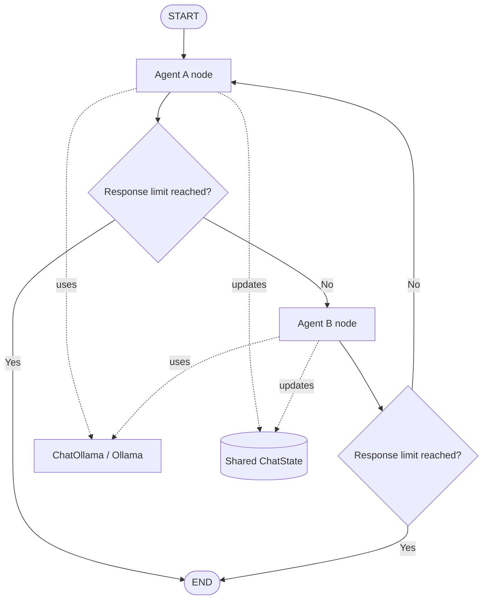

# EmoAgent Lite 🤖💬

### A modular, multi-agent conversational system built with LangGraph and Ollama

> **EmoAgent Lite** is an evolving multi-agent project for experimenting
> with conversational roles, monitoring, character-driven interaction,
> and evaluation. It starts with two agents discussing a topic and grows
> in planned versions toward a monitored, user-facing emotional-support
> research prototype.


------------------------------------------------------------------------

## Project roadmap

### V1 — Agent Conversation
- Agent A: optimistic and constructive.
- Agent B: analytical and constructively critical.
- Shared conversation state and alternating turns.
- Configurable response limit and empty-response checks.
- Local LLM integration through Ollama.

### V2 — Monitor Agent, Character Agent, and User Interaction
- Add a Character Agent for user-facing conversations.
- Add a Monitor Agent to inspect interaction quality and configured safety rules.
- Explore consent-based use of PHQ-9 questionnaire data as structured context.
- Treat PHQ-9 as screening information, not a diagnosis; define privacy and retention rules first.

### V3 — EmoGuard and EmoEval
- **EmoGuard:** checks outputs against defined safety and privacy rules.
- **EmoEval:** evaluates relevance, empathy, consistency, and instruction following.
- Use documented test cases and structured results.

### V4 — Backend and Frontend
- Expose the workflow through a FastAPI backend.
- Add a chat frontend, request/response schemas, error handling, and tests.
- Keep secrets and sensitive data out of frontend code and logs.

### V5 — Results Showcase
- Present example conversations, architecture, screenshots, and demo material.
- Report test results, latency/resource measurements, limitations, and evaluation methodology.
- Avoid unsupported claims of clinical effectiveness.

## V1 architecture



**Key idea:** LangGraph controls which agent runs next; the LLM generates what the agent says. V1's two roles can use the same underlying model with different prompts.

## Project structure

```text
EmoAgent-Lite/
├── agent/
│   ├── __init__.py
│   ├── state.py       # Shared graph state and message reducer
│   ├── prompts.py     # Agent roles and instructions
│   ├── nodes.py       # Transcript, LLM call, response validation
│   ├── edges.py       # Optional; routing currently lives in graph.py
│   └── graph.py       # Nodes, transitions, stopping condition
├── llm/
│   ├── __init__.py
│   └── provider.py    # Ollama model configuration
├── tests/
├── run_agent.py
├── .env.example
├── pyproject.toml
└── README.md
```

`api/` and `frontend/` can be added for V4.

## Requirements

- Python version compatible with the project's dependencies
- [Poetry](https://python-poetry.org/)
- [Ollama](https://ollama.com/)
- A model pulled into Ollama, for example `llama3.1:8b`

Install dependencies in an existing Poetry project:

```bash
poetry install
```

Or add the main packages when setting up dependencies:

```bash
poetry add langgraph langchain-ollama python-dotenv
poetry add --group dev pytest ruff
```

## Quick start

1. Start Ollama and pull a model:

   ```bash
   ollama pull llama3.1:8b
   ```

2. Create `.env`:

   ```dotenv
   OLLAMA_MODEL=llama3.1:8b
   OLLAMA_BASE_URL=http://localhost:11434
   ```

3. Run the entry point (adjust the filename if yours differs):

   ```bash
   poetry run python run_agent.py
   ```

4. Run tests:

   ```bash
   poetry run pytest
   ```

Never commit `.env`, credentials, or real user questionnaire data.

## Main modules

| File | Responsibility |
|---|---|
| `llm/provider.py` | Creates the `ChatOllama` client. |
| `agent/state.py` | Defines `ChatState`; `add_messages` accumulates message updates. |
| `agent/prompts.py` | Defines each agent's personality and dialogue rules. |
| `agent/nodes.py` | Builds model input, calls the LLM, validates output, updates state. |
| `agent/graph.py` | Registers nodes, connects them, and stops the graph at the response limit. |
| `agent/edges.py` | Not needed yet: V1 routing is in `graph.py`. Separate it when routing grows. |

## Troubleshooting

- **Ollama connection error:** check that Ollama is running, the base URL is correct, and the model appears in `ollama list`.
- **Empty agent response:** keep the validation check, inspect response metadata, and test the exact prompt directly through `ChatOllama`.
- **Agents talk about each other in third person:** instruct them to speak directly to the other participant in first-person dialogue.

## Safety and scope

Future PHQ-9-related functionality involves sensitive mental-health information. Obtain informed consent, minimize storage, define access and deletion controls, and do not present questionnaire scores or model outputs as a diagnosis or substitute for professional care. Technical functionality, conversation evaluation, and clinical validation are different things.

## V1 checklist

- [ ] Verify Agent A and Agent B produce non-empty responses.
- [ ] Confirm messages accumulate in the shared state.
- [ ] Confirm the response limit stops the graph correctly.
- [ ] Add tests for routing, errors, and state updates.
- [ ] Save representative examples and document limitations.

## License

No license is specified yet. Add a `LICENSE` file if you intend to publish the project as open source.
